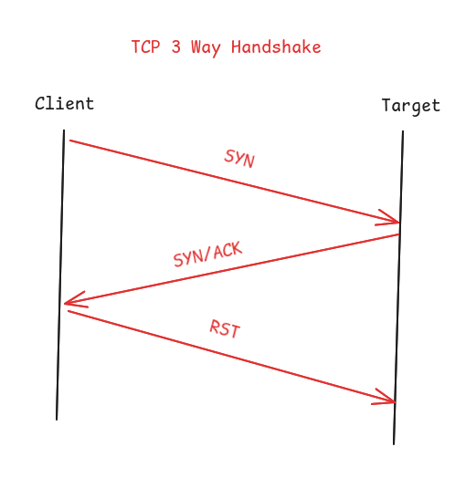

# Networking Cheat Sheet

## OSI Model

> **OSI (Open System Interconnection)** adalah sebuah konsep yang dikembangkan oleh International Organization for Standardization (ISO) tentang bagaimana cara data dikirim dan diterima oleh jaringan komputer, tujuannya menciptakan standar global agar perangkat lunak (Software) dan perangkat keras(Hardware) dapat saling berkomunikasi

### 7 OSI Layers

| Layer        | Definition                                                                                                                            | Example                                       |
| ------------ | ------------------------------------------------------------------------------------------------------------------------------------- | --------------------------------------------- |
| Application  | Antarmuka utama antara aplikasi dan jaringan komputer                                                                                 | HTTP, HTTPS, FTP, SMTP, DNS                   |
| Presentation | Menerjemahkan, mengenkripsi dan mengompres data agar sesuai format                                                                    | SSL, TLS, ASCII, JPEG, MIDI, MPEG             |
| Session      | Membuka, menjaga dan menutup sesi ketika pertukaran data berlangsung                                                                  | NetBIOS, RPC, NFS, SMB                        |
| Transport    | Mengatur cara pengiriman data seperti memecah menjadi paket-paket kecil (segments), memastikan data tidak hilang dan menyusun kembali | TCP, UDP                                      |
| Network      | Menentukan jalur (routing) agar paket data sampai ke tujuan                                                                           | IP (IPv4/IPv6), ICMP, OSPF, Router            |
| Data Link    | Mengatur pengiriman data antar perangkat yang terhubung dalam 1 jaringan menggunakan MAC Address                                      | Ethernet, Wi-Fi (IEEE 802.11), Switch, Bridge |
| Physical     | Mengubah data digital menjadi sinyal fisik seperti listrik, cahaya, gelombang radio                                                   | UTP Cable, Fiber                              |

### Transmission Connect Protocol (TCP) 3 Way Handshake



|     |                                                                                       |
| --- | ------------------------------------------------------------------------------------- |
| SYN | SYN / Synchronize adalah proses client mengirim paket ke target untuk meminta koneksi |
| ACK | ACK / Acknowledge adalah proses server menerima paket permintaan koneksi              |
| RST | RST / Reset adalah proses memutuskan koneksi secara paksa dan instan                  |

### Common Port Service

| Port | Name                      | Description                                                                                        |
| ---- | ------------------------- | -------------------------------------------------------------------------------------------------- |
| 20   | FTP-data                  | File Transfer Protocol data transfer                                                               |
| 21   | FTP                       | File Transfer Protocol (FTP) control connection                                                    |
| 23   | Telnet (Teletype Network) | network protocol that allows users to remotely access and manage devices or systems over a network |
| 79   | Finger                    | Give information about user currently logged in                                                    |
| 80   | HTTP                      | Uncrypted web service                                                                              |
| 443  | HTTPS                     | Encrypted web service using ssl                                                                    |
| 6379 | Redis server              | Redis database port server                                                                         |

## Linux Networking & CLI Quick Reference

```bash
# Cek IP Address & Interface
ip a
ifconfig
ip addr

# Diagnosis koneksi dan DNS
ping <IP/DOMAIN> # Tes konektivitas
traceroute <IP/DOMAIN> # Melacak jalur hop data
whois <IP/DOMAIN> # Menampilkan informasi tentang kepemilikan IP/Domain secara detail
dig <domain> @<dns-server-ip> # Menampilkan informasi tentang DNS lebih detail

openvpn filename.ovpn # Menghubungkan koneksi vpn
```

## Nmap CLI Quick Reference

```bash
# SCAN TECHNIQUES:
nmap -sS <IP/DNS> # SYN scan / stealth scan
nmap -sU <IP/DNS> # UDP scan
nmap -sT <IP/DNS> # TCP connect scan
nmap -sN, -sF, sX <IP/DNS> # NULL, Finn, Xmas

# OS Detection
nmap -O <IP/DNS> # Deteksi OS

# SERVICE/VERSION DETECTION:
nmap -sV <IP/DNS> # Deteksi service version

# OUTPUT
nmap -v <IP/DNS> # verbose
nmap -vv <IP/DNS> # High verbose
nmap -oA <IP/DNS> # Save with 3 major format
nmap -oN <IP/DNS> # normal format
nmap -oG <IP/DNS> # Grep format

# MISC
nmap -A <IP/DNS> # Aggresive mode

# Timing & Performance
nmap -T<1-5> <IP/DNS> # Speed scan
nmap -p- <IP/DNS> # Scan all port
nmap -p <port-range> <IP/DNS> # Scan port with range
```

### Nmap Scripting Engine (NSE)

script NSE path: /usr/share/nmap/scripts

| Category  | Detail                                                                                                   |
| --------- | -------------------------------------------------------------------------------------------------------- |
| safe      | Won't affect the target                                                                                  |
| intrusive | Not safe: likely to affect the target                                                                    |
| vuln      | Scan for vulnerabilities                                                                                 |
| exploit   | Attempt to exploit a vulnerability                                                                       |
| auth      | Attempt to bypass authentication for running services (e.g. Log into an FTP server anonymously)          |
| brute     | Attempt to bruteforce credentials for running services                                                   |
| discovery | Attempt to query running services for further information about the network (e.g. query an SNMP server). |

```bash
nmap -sC <IP/DNS> # Using default script
nmap -script=script <IP/DNS> # Using specific script
```

## References

- Intro to networking - [https://tryhackme.com/module/intro-to-networking](https://tryhackme.com/module/intro-to-networking)
- Nmap book - [https://nmap.org/book/](https://nmap.org/book/)
- Common port - [https://www.geeksforgeeks.org/computer-networks/50-common-ports-you-should-know/](https://www.geeksforgeeks.org/computer-networks/50-common-ports-you-should-know/)
